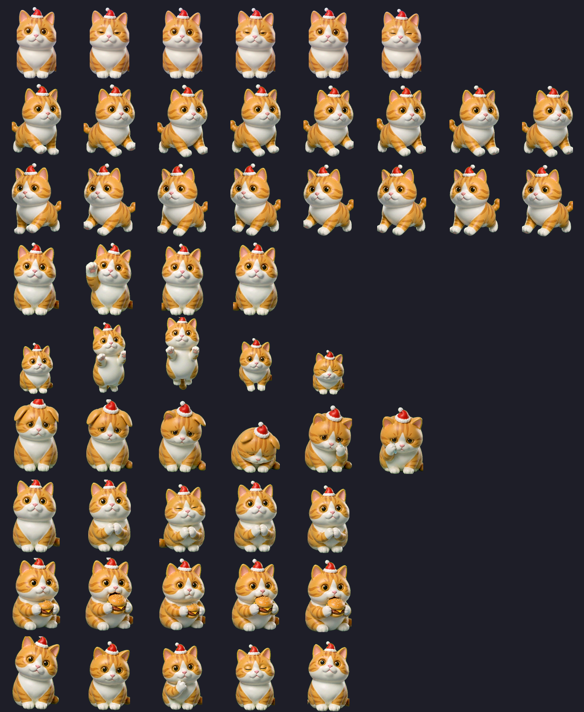

# 麦麦猫 · McdCat Pet

> 你在麦当劳点了什么，这只猫就吃什么。
> 它同时是一个跑在 Codex 桌面的真桌宠，和一个可以直接打开的网页桌宠。


**Codex 桌面挂件的九个动作**（一张图看全）：



| 行 | Codex 状态 | 麦麦猫在干什么 |
|---|---|---|
| 0 | `idle` | 坐着呼吸、眨眼 |
| 1 | `running-right` | 向右小跑去麦当劳上班 |
| 2 | `running-left` | 向左小跑（由右向镜像） |
| 3 | `waving` | 举爪招手迎客 |
| 4 | `jumping` | 蹲跳接汉堡（抛物线） |
| 5 | `failed` | 任务失败：耷耳朵、委屈 |
| 6 | `waiting` | 双爪合十讨食 |
| 7 | `running` | **抱着汉堡埋头苦干** —— Codex 干活时的默认动作 |
| 8 | `review` | 歪头审视，像美食评委 |

---

## 一、它到底是什么

两件事，一套资产：

**1. Codex 桌面桌宠。** 装进 `~/.codex/pets/`，在 Codex 的桌宠选择器里选「麦麦猫」，它会一直待在你的屏幕上。你让 Codex 跑任务时，它在旁边抱着汉堡啃；任务失败时它耷下耳朵。

**2. 网页桌宠 + 麦当劳 MCP 联动。** 打开 `index.html`（推荐用 `python tools/order_server.py --open` 启动），可以投喂 12 道真实麦当劳餐品、让它睡觉打呼、双击切换动作、一键贴到悬浮小窗。真正的用法是联动：你在 WorkBuddy / Codex 里用麦当劳 MCP 点完单，Agent 跑一行 `order_hook.py`，猫就开始吃你点的那份餐，并弹出卡路里和价格。

**3. 桌面悬浮桌宠（WorkBuddy / Codex 通用，交互最完整）。** `python tools/desktop_pet.py` 在桌面开一个无边框、透明、置顶、可拖动的小窗——就是一只贴在桌面上的猫。**单击小猫**，猫的左右两侧弹出「🍗 投喂」「💤 睡觉」按钮；点「投喂」，猫下方展开 12 道餐品的真实图案托盘，点哪个图案猫就吃哪个。空闲自动遛弯（静默不打扰），MCP 点餐自动开吃。WorkBuddy 悬浮窗与 Codex 桌宠跑的是**同一套资产、同一个交互**。

```bash
# 终端 A：起点餐桥（托管网页 + 接收订单事件）
python tools/order_server.py          # → http://127.0.0.1:8787/

# Codex/Agent 侧：MCP 下单成功后
python tools/order_hook.py --code 1440        # 自动查 menu_map.json 补全价格/热量
```

菜单不是编的 —— 12 个餐品的名称、编码、价格全部来自麦当劳 MCP `query-meals` 的真实返回，映射表在 [menu_map.json](menu_map.json)。

---

## 二、安装

### 0. 最快开始

```bash
git clone https://github.com/ellenfengyunjing/mcdonald-pet.git
cd mcdonald-pet
python tools/desktop_pet.py        # 桌面悬浮猫，单击/双击即可玩
```

本仓库本身就是一套可直接使用的 **WorkBuddy Skill**：整个目录复制到
`~/.workbuddy/skills/mcd-cat-pet/`，之后在 WorkBuddy 对话里说「喂猫」「让猫吃个巨无霸」即可触发。

### 方式 A：装成 Codex 桌面桌宠（推荐）

```bash
# 1. 构建图集（读 pet.json，输出 dist/spritesheet.png；构建时自动清蓝/青残渣）
python tools/build_spritesheet.py

# 2. 装进 Codex
python tools/install_codex.py
```

> **脸上有蓝/青色像素？** 那是生成图抠底残留的 chroma-key 污染。
> 跑 `python tools/despill_blue.py --check` 统计、不带参数直接清理源帧，
> 然后重新 build + install。`build_spritesheet.py` 已内置清理步骤，正常不会再出现。

然后**完全退出 Codex 再重开**（托盘图标 → Quit，不是关窗口），在桌宠选择器里选「**麦麦猫**」。

> **选了却看不到？** 先跑 `python tools/install_codex.py --check-only` 体检。
> 最常见的原因是 Codex 的桌宠浮窗总开关被关掉了：全局状态里的
> `electron-avatar-overlay-open` 必须是 `true`。安装脚本会自动修好它，
> **但必须先把 Codex 完全退出**，否则运行中的进程会把改动覆盖回去。
> 完整排查清单见 [TROUBLESHOOTING.md](TROUBLESHOOTING.md)。

### 方式 B：直接用网页版

双击 `index.html` 即可，零依赖、零构建。所有动画帧和食物道具都在 `assets/` 里，本地加载。

要接「MCP 点单联动」，改用点餐桥启动（同一个页面，多了订单事件接口）：

```bash
python tools/order_server.py --open   # 启动并自动打开浏览器
```

### 方式 C：桌面悬浮桌宠（交互最完整）

```bash
python tools/desktop_pet.py           # 无边框·透明·置顶·可拖动的桌面猫
python tools/desktop_pet.py --x 900 --y 500   # 指定初始位置（位置会记住）
```

交互一览（悬浮窗 = 网页版 = Codex 版，完全一致）：

| 操作 | 效果 |
|---|---|
| **单击小猫** | 猫左右两侧弹出「🍗 投喂」「💤 睡觉」两个按钮；点空白或再点小猫收起 |
| **点「投喂」** | 猫下方展开 12 道餐品真实图案托盘（悬停显示全名·kcal·价格），点图案即投喂：汉堡/薯条走「吃」，可乐/奶铁走「喝」，食物贴在嘴边**越吃越小**，吃完自动「满足」→ 眯一会儿 → 回休闲 |
| **点「睡觉」** | 闭眼打呼 + Zzz；单击/双击叫醒 |
| **双击小猫** | 手动切换动作：静坐 → 走来走去 → 扑向你 → 休息（睡着时双击 = 叫醒） |
| **无人操作** | 按同一顺序自动循环，但**保持安静不出文字**，不遮挡屏幕 |
| **MCP 点餐** | `order_hook.py` 推送 → 自动识别餐品开吃，弹出餐名·价格·热量，吃完自己休息 |

**文字按需显示**：只有在切换状态/投喂/来单时才出现文字。顶部消息框显示当前动作或订单提醒，底部记账框显示「本次 kcal·金额 ｜ 累计 餐数·kcal·金额」；两个框都**随文字宽度自适应**，回休闲后自动收起，画面里只剩一只猫。

依赖 `Pillow` + `tkinter`（Python 标准库自带，无需浏览器内核、无需 WebView2）：

```bash
pip install pillow
```

> **用哪个 Python？** Windows 上请用**系统安装的 Python 3.11**（自带 tkinter）；
> venv/自行编译的解释器可能没编译 tkinter 模块。Mac/Linux 用系统 Python 即可。

### 依赖

只需要 Python 3 + Pillow：

```bash
pip install pillow
```

---

## 三、使用示例

### 网页桌宠 / 桌面悬浮窗

交互与桌面悬浮窗完全一致（同一份状态机）：

- **单击小猫** —— 左右两侧弹出「🍗 投喂」「💤 睡觉」；点投喂后猫下方展开 **12 道真实餐品图案托盘**，点哪道吃哪道：汉堡/麦乐鸡走「吃」，可乐/奶铁走「喝」，食物贴在嘴边越吃越小；吃完进入「满足」→ 自动眯一会儿 → 回休闲
- **睡觉** —— 闭眼打呼，头顶飘 Zzz；再点一次叫醒
- **悬浮小窗** ——（网页版）把桌宠装进原生画中画小窗，贴边陪玩；（桌面版）本来就是一个真桌面悬浮窗
- **双击小猫** —— 手动切换动作：静坐 → 走来走去 → 扑向你 → 打盹休息（睡着时双击 = 叫醒）

**没事它自己也会动**：空闲时自动按同一顺序循环——静坐 → 左右遛弯 → 扑向你 → 打盹。为了让画面干净，**自动循环时不弹任何文字**；只有你主动操作、投喂或来单时才出现提示框。

吃得越多猫越胖（胖度 0–6 级，横向 +4.5%/级）。**顶部消息框** + **底部记账框**（本次/累计 kcal 与金额，框宽随文字自适应、回休闲自动收起）。网页版存档在 localStorage，关掉浏览器也记得。

### 跟麦当劳 MCP 联动

Agent 侧的完整链路（以 WorkBuddy / Codex 中的 MCP 调用为例）：

```text
1. query-nearby-stores  → 找到门店，拿到 storeCode
2. query-meals          → 拿到真实菜单与商品编码
3. calculate-price      → 算价，带券对比
4. create-order         → 下单（需用户二次确认）
5. python tools/order_hook.py --code <编码>
   → 推送给点餐桥 → 猫开吃 + 弹「餐名 · ¥价格 · ≈kcal」→ 吃完自己眯一会儿
```

`order_hook.py` 给 `--code` 就能自动查 `menu_map.json` 补全名称/价格/热量；点餐桥没开时订单会暂存到 `~/.codex/pets/mcd-maimai/orders_pending.jsonl`，下次启动自动补发，**订单永不丢**。页面刷新不会重放旧订单（游标持久化 + 首次访问快进）。

兜底链与页面 API 不变：`McdPet.onOrdered(name | {name, price, kcal})` 精确匹配菜单 → 编码匹配 → 关键词猜类型（喝的走喝动画，其余走吃动画 + emoji 占位）。**真实订单里任何餐品都有对应动作，不会静默失败**。

想看它现在吃了多少：

```js
McdPet.stats()   // { kcal: 950, cost: 62.5, meals: 3, fat: 3, log: [...] }
```

### 在对话里直接玩

WorkBuddy 会话里可以直接渲染这个桌宠（读 `assets/` 绝对路径），点按钮即播动画。它不是全局浮窗，随对话流出现。

---

## 四、目标用户

- **用 Codex / WorkBuddy 写代码，又想让桌面有点活气的人** —— 桌宠本来就是给自己看的
- **麦当劳 MCP 的开发者** —— 给冷冰冰的下单流程加一个看得见的反馈层，点完单有个东西替你吃掉它
- **想做自己桌宠的人** —— 这套工具链是通用的，换形象只需要换一批帧（见下节）

---

## 五、通用化：换成你自己的宠物

麦当劳主题只是第一个配置。形象、动作、行序全部由 [`pet.json`](pet.json) 驱动：

```jsonc
{
  "id": "custom:mcd-maimai",
  "displayName": "麦麦猫",
  "description": "…",
  "spritesheet": {
    "cell": { "width": 192, "height": 208 },
    "grid": { "columns": 8, "rows": 9 },
    "rows": [
      { "row": 0, "state": "idle", "dir": "run-codex/frames/idle", "mirror": false, "maxFrames": 8 },
      { "row": 1, "state": "running-right", "dir": "run-codex/frames/running-right", "mirror": false },
      { "row": 2, "state": "running-left",  "dir": "run-codex/frames/running-right", "mirror": true },
      // …其余 6 行
    ]
  }
}
```

换形象三步：

1. 把你的动画帧按 `assets/frames-<主题>/<状态>/f00.png…` 放好
2. 改 `pet.json` 里的 `dir`、`displayName`、`description`
3. `python tools/build_spritesheet.py && python tools/install_codex.py`

`mirror: true` 会自动生成左右反向的行（我们只用一组向右跑的帧就得到了向左跑），省一半生图成本。

想从头生成一整套动画帧？流程与踩坑都记在 [SKILL.md](SKILL.md) 里，脚本在 `tools/`：

| 脚本 | 作用 |
|---|---|
| `build_spritesheet.py` | 帧目录 → Codex 契约图集（含体积优化与契约自检） |
| `install_codex.py` | 装进 `~/.codex/pets/`，并修好浮窗总开关 |
| `slice_codex.py` | 生图条带 → 透明帧（支持模型画成 2×N 网格的情况） |
| `slice_strips.py` | 网页版六状态用的切帧器 |
| `process_food.py` | 食物道具抠底（边框洪泛） |
| `grab_latest.py` | 按修改时间抓取生图产出（并发调用会串位，必须串行） |

---

## 六、目录结构

```text
mcdonald-pet/                   ← 本仓库本身就是一套 WorkBuddy Skill（整目录复制到 ~/.workbuddy/skills/mcd-cat-pet/ 即可）
├── README.md                   ← 你在这里
├── CONTEST_DECLARATION.md      参赛声明
├── MCP_INTEGRATION.md          麦当劳 MCP 调用链路与业务价值
├── mcp-config.example.json     脱敏 MCP 配置（只有环境变量占位符）
├── workbuddy.md                WorkBuddy 联动上下文
├── SKILL.md                    Skill 说明（触发词、工作流、踩坑）
├── AGENTS.md                   Codex / WorkBuddy 侧的 Agent 使用说明
├── TROUBLESHOOTING.md          桌宠不显示等问题的排查清单
├── pet.json                    ★ 桌宠源配置（换形象改这里）
├── menu_map.json               ★ 麦当劳真实菜单 → 动画道具映射
├── index.html                  网页桌宠（零依赖，双击即开）
├── assets/
│   ├── frames/                 网页版六状态动画帧
│   └── food/                   12 个透明底食物道具
├── run-codex/frames/           Codex 九行动画帧
├── dist/                       构建产物（图集）
├── qa/                         README 用到的动图预览（本地自检产物已 gitignore）
└── tools/                      构建 / 安装 / 切帧 / 打包脚本
    ├── desktop_pet.py          ★ 桌面悬浮桌宠（tkinter，WorkBuddy & Codex 通用）
    ├── order_server.py         点餐桥：托管网页 + 订单事件接口
    ├── order_hook.py           MCP 下单成功后推送的一行命令
    └── …                       帧处理 / 图集构建 / Codex 安装脚本
```

---

## 七、说明

- **热量数字是趣味可视化，不是营养建议。** kcal 来自麦当劳 MCP `list-nutrition-foods` 官方营养表快照（以门店实际为准）。本项目的记账只做「记录与呈现」，**不提供减脂、控卡或任何饮食指导**。
- 交互动作只保留「投喂」和「睡觉休息」两个，加上双击切换与自动闲逛——全部是拟猫行为的可爱化表达，无排泄物等不雅元素。
- 食物道具是 3D 玩具质感插画，用于指代对应餐品，不代表麦当劳实物出品标准。
- 本项目的形象、动画帧、代码均为原创生成，未使用麦当劳官方素材。

---

## 八、许可与鸣谢

代码与脚本 MIT。动画形象由 AI 生成，基于用户提供的自家猫咪照片二次创作。

麦当劳商品名称与编码来自麦当劳 MCP 公开接口返回，仅用于功能演示。
